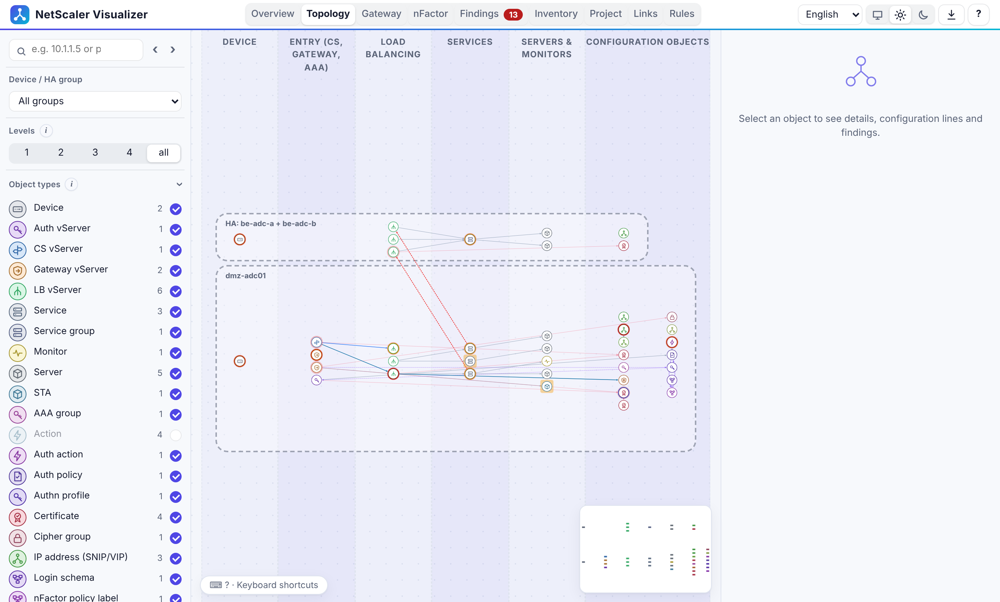
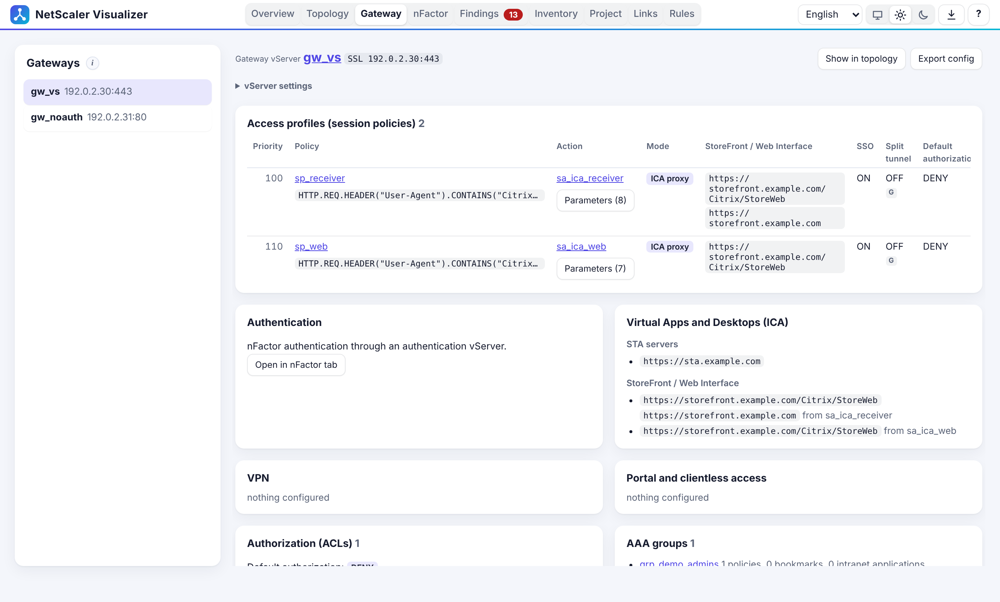
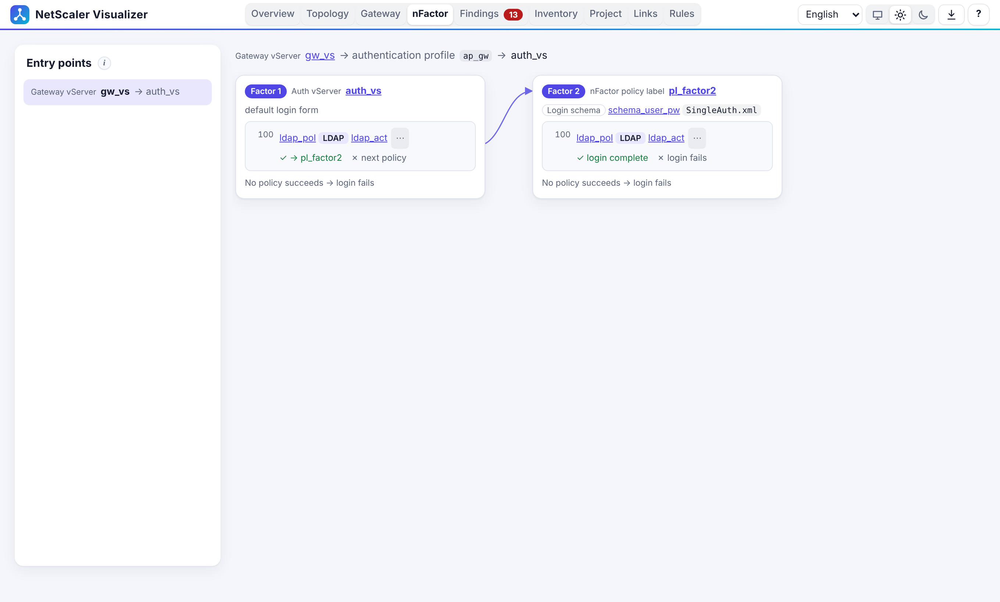
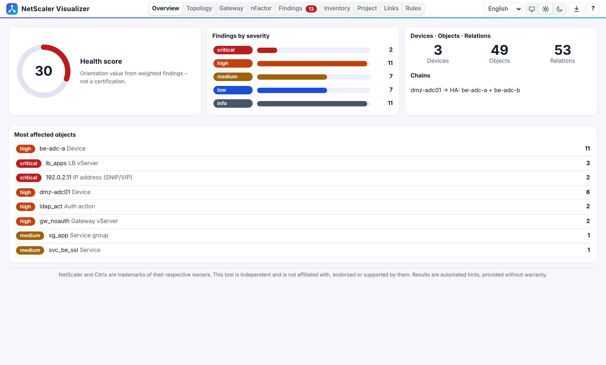
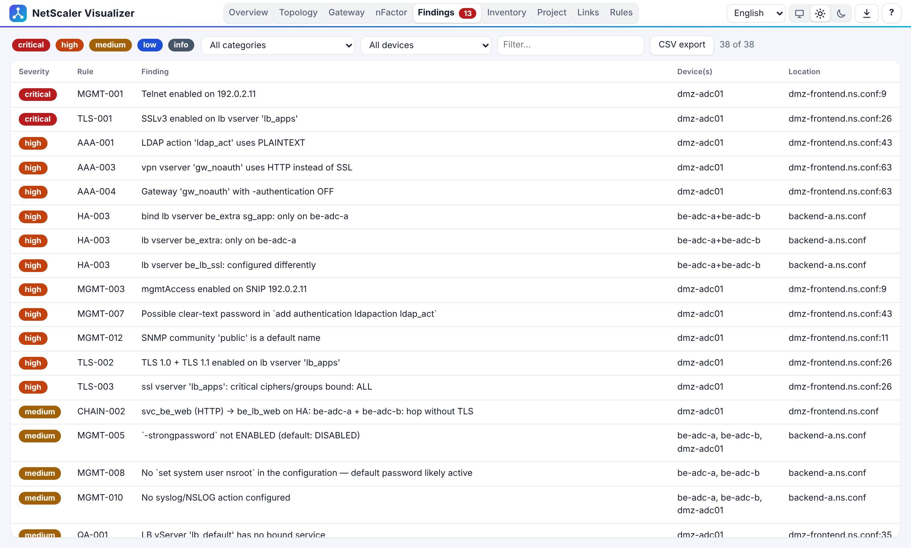

# NetScaler Visualizer (`nsviz`)

🇬🇧 [English version](README.md)

**Die ganze NetScaler-Umgebung auf einer Seite sehen – und wissen, was daran nicht stimmt.**

Eine oder viele `ns.conf`-Dateien hineingeben und **eine einzige HTML-Datei** erhalten, die sich überall offline öffnen
lässt. Nichts wird hochgeladen, auf dem NetScaler wird nichts installiert.



## Die wichtigsten Funktionen
| | |
|---|---|
| 🗺️ **Topologie** | Interaktive Karte aus vServern, Services, Policies, Zertifikaten und Authentifizierung – nach Ebenen, filter- und durchsuchbar. |
| 🔗 **Mehrere NetScaler** | HA-Paare zusammengefasst und verglichen, Double-Hop-Ketten (DMZ → intern → Backend) über Geräte hinweg verfolgt. |
| 🚪 **Gateway-Ansicht** | Je Gateway: Session-Policies mit wirksamen Werten (inkl. globaler Vorgaben), StoreFront/STA, EPA, Client-Zertifikate, ACLs. |
| 🔐 **nFactor-Ablauf** | Der Login-Ablauf je Einstiegspunkt als Faktor-Spalten: Schemas, Policies, Actions, Erfolgs-/Fehlerpfade. |
| ✅ **Prüfungen** | Rund 60 Regeln (Fehlkonfiguration, Hersteller-Best-Practice, BSI-Hinweise) mit Begründung, Quelle und Behebung; Gesundheitswert. |
| 🧹 **Bereinigung** | Findet ungenutzte Konfiguration und schreibt einen geordneten Bereinigungs- sowie einen Rollback-Batch. |
| 📤 **Export** | PNG/SVG/PDF, CSV und ausgewählte Objekte als NetScaler-Config (mit ihren Abhängigkeiten). |
| 🕶️ **Datenschutz** | Secrets standardmäßig maskiert; Configs zum Weitergeben anonymisieren; läuft nur auf 127.0.0.1. |
| 🌍 **Sprachen** | Oberfläche in 8 Sprachen, Hell/Dunkel, Tastatursteuerung. |

<table><tr>
<td></td>
<td></td>
</tr><tr>
<td></td>
<td></td>
</tr></table>

Alle Screenshots zeigen die erfundene Demo-Umgebung aus [`examples/demo`](examples/demo) (Dokumentations-IP-Bereiche,
ausgedachte Namen).

## Erste Schritte
### Variante A – fertige App (kein Python nötig)
`nsviz-windows-x64.exe`, `nsviz-macos-arm64` (Apple Silicon) oder `nsviz-macos-x64` (Intel) von der Seite *Releases*
laden und starten: Im Browser öffnet sich eine lokale Seite.

Die Builds sind **nicht code-signiert**:
- **Windows:** SmartScreen meldet „Der Computer wurde durch Windows geschützt“ → *Weitere Informationen* → *Trotzdem ausführen*.
- **macOS:** Gatekeeper blockiert den ersten Start. Rechtsklick auf die Datei → *Öffnen* → *Öffnen*, oder im Terminal
  `xattr -d com.apple.quarantine nsviz-macos-arm64 && chmod +x nsviz-macos-arm64`.

### Variante B – mit Python ≥ 3.10 (keine Pakete nötig)
```bash
git clone https://github.com/ITCMA/NetScaler-Visualizer.git && cd NetScaler-Visualizer
python3 -m nsviz gui                                   # lokale Seite: Configs ablegen, Optionen setzen, Report erstellen
python3 -m nsviz analyze examples/demo -o demo.html   # oder direkt per Kommandozeile (Demo-Daten)
```

### Der erste Report
1. Auf jedem NetScaler die laufende Config sichern (`save ns config`) und `/nsconfig/ns.conf` kopieren.
2. `nsviz gui` starten, Dateien ablegen, HA-Paare markieren, falls sie nicht erkannt werden, Report erstellen.
3. HTML-Datei öffnen. Am besten mit **Übersicht** beginnen, dann **Topologie**, **Gateway** und **nFactor**.
   Der Report enthält die Topologie – wie Kundendaten aufbewahren und weitergeben.

### Kommandozeile
```bash
# einzelnes Gerät, Ordner mit mehreren Configs oder beides
python3 -m nsviz analyze kunde/adc01.conf kunde/adc02.conf -o report.html --csv befunde.csv --lang de

# HA-Paar explizit angeben (sonst nur Erkennung über `add ha node`), Rollen setzen
python3 -m nsviz analyze configs/ --ha pri.conf,sec.conf --role pri.conf=primary --role sec.conf=secondary

# CI-Job bei kritischen Befunden scheitern lassen (Exit-Code 2)
python3 -m nsviz analyze configs/ -o report.html --fail-on critical

# anonymisierte Kopien von Configs (zum Weitergeben oder für die Entwicklung), siehe docs/PRIVACY.de.md
python3 -m nsviz anonymize configs/ -o anonymized/            # alles anonymisiert (Standard)
python3 -m nsviz anonymize configs/ -o anonymized/ --keep ips   # IP-Adressen behalten
python3 -m nsviz anonymize configs/ -o anonymized/ --remove comments,timezone,location

# Regelkatalog (Deutsch), Tests
python3 -m nsviz rules --markdown --lang de > docs/RULES.de.md
python3 -m unittest discover -s tests
```

Unterstützt NetScaler 13.1 / 14.1 / 15.1. Einziger Netzzugriff ist die optionale, von Hand gestartete DNS-Auflösung
im Reiter Verknüpfungen.

> **Marken / Unabhängigkeit:** NetScaler und Citrix sind Marken der jeweiligen Rechteinhaber. Dieses Projekt ist
> unabhängig und weder mit diesen verbunden noch von ihnen unterstützt oder empfohlen. Ergebnisse sind automatisierte
> Hinweise ohne Gewähr. Siehe [docs/LEGAL.de.md](docs/LEGAL.de.md).

## Funktionen im Detail
### Visualisierung und Multi-Instanz-Sicht
- **Topologie** (Cytoscape + dagre, alles eingebettet): Zoom/Pan, Doppelklick klappt Unterstrukturen ein/aus, Ebenen 1–4,
  Filter nach Objektart, nur Objekte mit Befunden, Suche (Name/IP/Config-Text), Umfeld-Hervorhebung, Kantenbeschriftung,
  PNG-Export. Rote Rahmen = Befunde (Farbe = Schweregrad).
- **Reiter Gateway** (erscheint, wenn die Config Gateway-vServer enthält): eine Seite je Gateway mit den Zugriffsprofilen
  (Session-Policies: ICA-Proxy, Voll-VPN, Clientless, StoreFront-URL und wohin sie führt, SSO, Split Tunnel,
  Standard-Autorisierung), STA-Servern, ICA-Policies, Intranet-Anwendungen und -IPs, Traffic-Policies, Portal-Theme,
  Lesezeichen, Clientless-Zugriff, Autorisierungs-Policies (ACLs), AAA-Gruppen, RDP/PCoIP-Profilen und weiteren gebundenen
  Policies; globale Bindungen und AAA-Gruppen sind gekennzeichnet. „Config exportieren“ exportiert das Gateway mit
  seinen Abhängigkeiten.
- **Bereinigung** (Seitenleiste der Topologie): findet Konfiguration, die nicht genutzt wird, von oben nach unten ab den
  adressierbaren vServern, GSLB-Domains, globalen und Benutzer-/Gruppen-Bindungen: z. B. nicht adressierbare vServer ohne
  Referenz, Services und Service Groups ohne vServer, danach die Monitore, Server, Policies, Actions und Zertifikate, die
  dadurch frei werden. Objekte, die nur von deaktivierten Objekten genutzt werden, sind gesondert gekennzeichnet. Beides
  wird im Graph hervorgehoben; „Bereinigungs-Batch“ im Export-Dialog schreibt die unbind-/rm-Befehle in ausführbarer
  Reihenfolge (zuerst Ungenutztes, der Teil zu deaktivierten Objekten mit Erklärung am Ende) sowie einen Rollback-Batch.
  Objekte, deren Name noch in einer bleibenden Zeile vorkommt, werden nur „zu prüfen“ aufgeführt. Zeilen mit maskierten
  Secrets (***) sind im Rollback auskommentiert und müssen aus der gesicherten ns.conf ergänzt werden (oder --no-redact).
- **Details zu Gateway und nFactor**: Parameter von Session- und Authentifizierungs-Actions in einem Overlay (mit den
  globalen VPN-Einstellungen), Client-Zertifikat-Anmeldung und Endpoint-Analyse (EPA); beide Reiter lassen sich als PNG,
  SVG oder PDF exportieren.
- **Reiter nFactor** (erscheint, wenn die Config Anmeldungen enthält): der Anmeldeablauf je Einstiegspunkt (Gateway,
  LB/CS-vServer mit Anmeldung, Authentifizierungs-vServer) als Faktor-Spalten: Login-Schema, Policies in
  Prioritätsreihenfolge mit Action-Typ (LDAP, RADIUS, SAML, OAuth, Zertifikat, Entscheidung, ...), Erfolg → nächster Faktor
  oder Anmeldung abgeschlossen, Fehler → nächste Policy oder Abbruch, Pfeile zwischen den Faktoren. Klassische
  Gateway-Anmeldung (primär/sekundär) wird ebenfalls gezeigt. In der Topologie haben die Details passender Objekte
  Schaltflächen, die diese Reiter öffnen.
- **Mehrere NetScaler in einem Bild:** HA-Paare (explizit mit `--ha` oder über `add ha node` erkannt) erscheinen als eine Gruppe mit
  Konfigurationsvergleich; Backend-Ziele, die zu einem vServer eines anderen Geräts passen, werden als **Double-Hop**-Kette verbunden
  (IP+Port = sicher, nur IP = als Annahme markiert).
- **Mehrsprachig, hell/dunkel:** Oberfläche in 8 Sprachen (de, en, es, fr, pt, zh, ja, hi), folgt der Browsersprache und ist
  umschaltbar. Hell/Dunkel folgt `prefers-color-scheme`, umschaltbar, Wahl wird im Browser gemerkt. Regeltexte und
  Befundmeldungen gibt es auf Englisch und Deutsch. Übersetzungen außer en/de sind nicht von Muttersprachlern geprüft.
- **Configs anonymisieren** (GUI Abschnitt 5 oder `nsviz anonymize`): auswählen, was ersetzt wird (Standard: alles; Geheimnisse werden immer entfernt; Kommentare, Zeitzone und Standort-/GeoIP-Angaben bleiben, außer die jeweilige Option "entfernen" ist angehakt). Einheitliche Pseudonyme erhalten Objekttyp, IP-Subnetze und privat/öffentlich, FQDN-Aufbau und intern/extern, LDAP-DNs und Produkt-URL-Pfade; eine Strukturprüfung vergleicht Objekte und Verbindungen vorher/nachher, verbleibende Prüfstellen werden lokal aufgelistet.
- **Debug-Modus** (standardmäßig aus; mit `--debug` beim Erstellen des Reports oder mit `#debug` in der Report-URL einschalten): eine 🐞-Schaltfläche im Kopf zeigt zu jeder Linie, welche Regel und welche Config-Zeile sie erzeugt hat; kopiert eine anonymisierte Beschreibung (keine Namen, IPs oder Werte), um falsche oder fehlende Linien zu melden. Umschalt-, Cmd- oder Wahltaste + Klick (oder mit Umschalttaste einen Rahmen ziehen) wählt mehrere Objekte und Linien für eine gemeinsame Beschreibung.
- **Export als NetScaler-Config:** die gewählten Objekte als Batch-Datei, wahlweise mit allen direkten und indirekten Abhängigkeiten, in der Reihenfolge der Quell-Config; Zertifikats-/Schlüsseldateien und globale Einstellungen werden als nicht enthalten aufgeführt.
- **Einheitliche Oberfläche (Startseite und Report):** Schalter, Segment-Schalter, einklappbare Abschnitte, Optionskarten und
  Info-Symbole (i) für längere Erklärungen, gleiches Bild in Hell, Dunkel und hohem Kontrast.
- **Barrierefreiheit/Bedienung:** Skip-Link, ARIA-Tabs, Fokusrahmen, Tastatursteuerung im Graph (Pfeile, Enter, +/−, 0, `/`,
  Cmd/Strg+F, Esc, `?` zeigt alle Kürzel), reduzierte Animationen, Übersichtsseite mit Gesundheitswert.
### Prüfungen
- **Befunde:** filterbar, Klick springt zum Objekt; Begründung, Quelle und Behebung je Regel; CSV-Export.
- **Inventar** aller vServer (sortierbar), **Projekt** (Geräte, HA-Diff, Double-Hop-Ketten), **Regeln** (Katalog).
- Kennwörter/Schlüssel in den eingebetteten Config-Zeilen werden standardmäßig maskiert (`--no-redact` schaltet das ab).
  Der Report enthält trotzdem Kundentopologie → wie Kundendaten behandeln ([docs/PRIVACY.de.md](docs/PRIVACY.de.md)).

## Grenzen (bewusst benannt)
- Aus einer `ns.conf` nicht prüfbar: Zertifikats-Ablaufdatum, Laufzeitstatus (UP/DOWN), das echte nsroot-Kennwort,
  Primary/Secondary-Rolle zur Laufzeit. Regeln dazu sind als `heuristic` bzw. `likely` gekennzeichnet.
- Defaultwerte einzelner Optionen unterscheiden sich je Version; Regeln melden deshalb nur *explizit* gesetzte unsichere
  Werte, außer es ist als Annahme dokumentiert.
- Die Verweise auf BSI-Bausteine und die Secure-Deployment-Hinweise des Herstellers sind auf Themenebene und nicht
  gegen die aktuellen Fassungen verifiziert.

## Dokumentation
[Architektur](docs/ARCHITECTURE.de.md) · [Regeln](docs/RULES.de.md) · [Quellen & Lizenzen](docs/SOURCES.de.md) ·
[Datenschutz / Kundendaten](docs/PRIVACY.de.md) · [Rechtliche Hinweise](docs/LEGAL.de.md) · [Sicherheit](SECURITY.md) ·
[Mitarbeit](CONTRIBUTING.md) · [Changelog](CHANGELOG.md) · [Drittkomponenten](THIRD_PARTY_NOTICES.md)

## Lizenz
Proprietär, alle Rechte vorbehalten – siehe [LICENSE](LICENSE).
