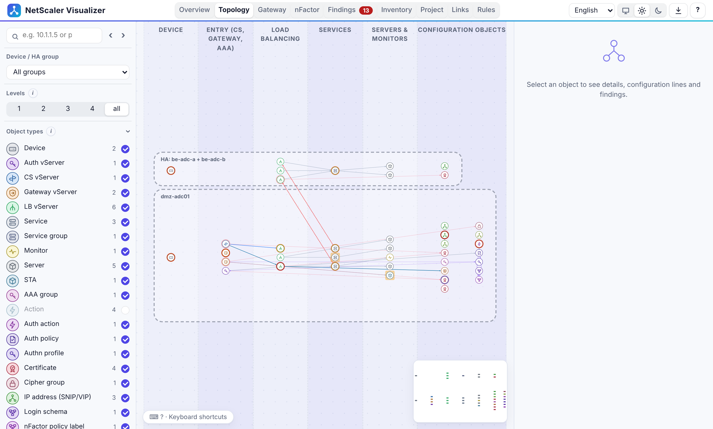
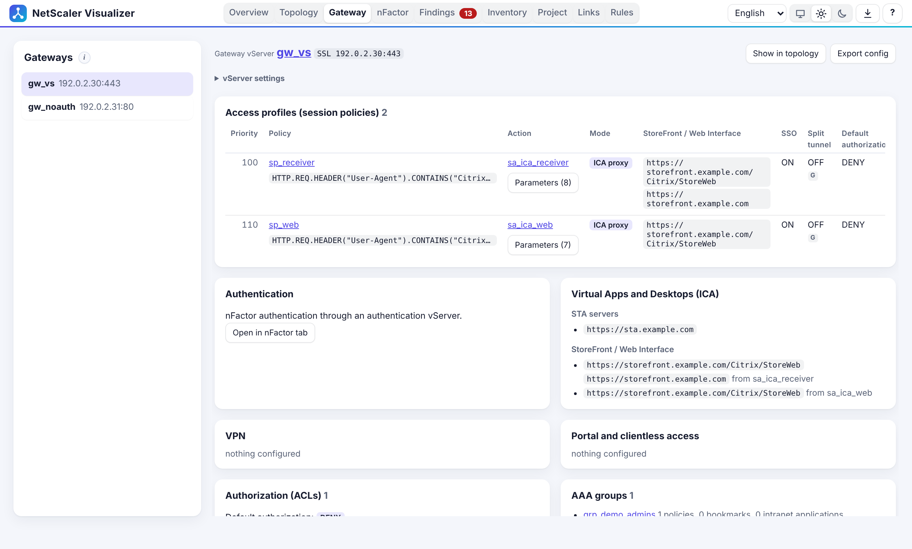
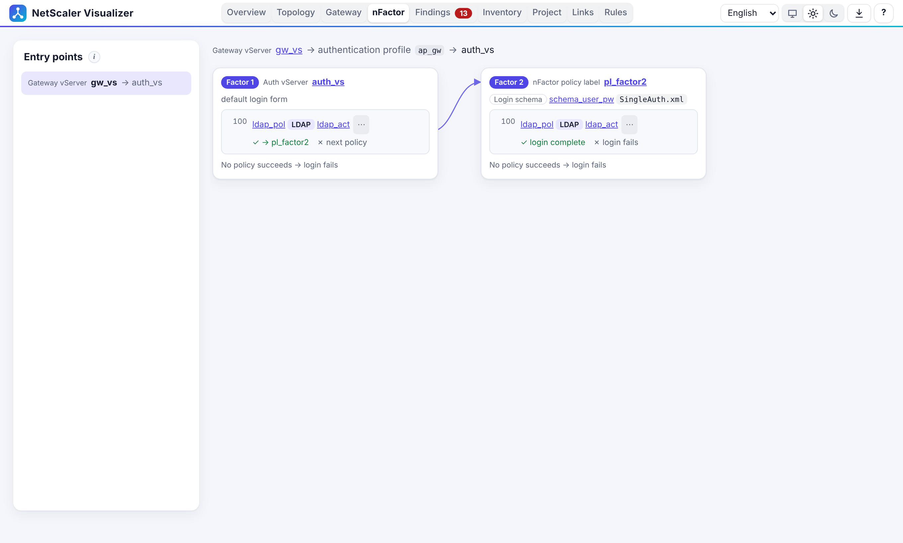
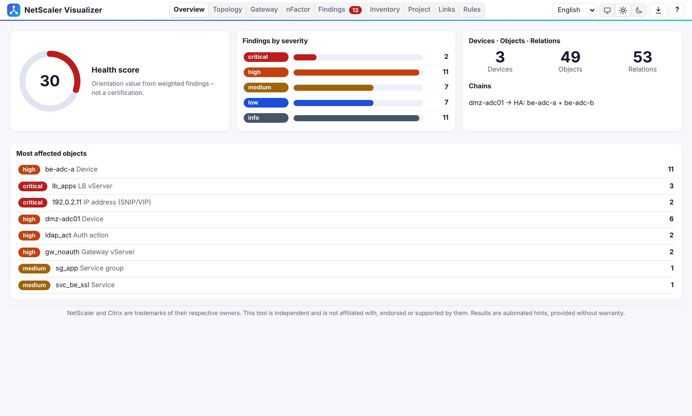
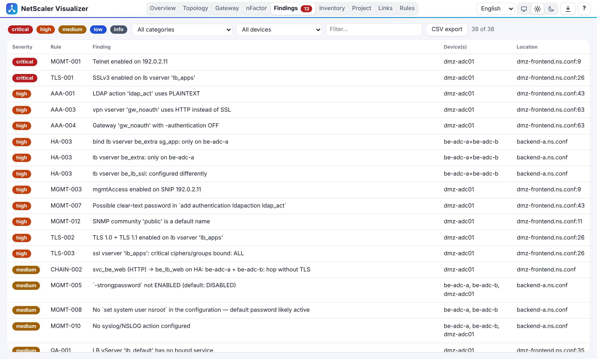

# NetScaler Visualizer (`nsviz`)

🇩🇪 [Deutsche Version](README.de.md)

**Visualize and check NetScaler configurations: the whole environment on one page.**

nsviz reads `ns.conf` files of one device or a whole landscape and produces **one self-contained HTML file** that opens
offline in any browser. Nothing is uploaded and nothing is installed on the NetScaler.



## Key features
| | |
|---|---|
| 🗺️ **Topology** | Interactive map of vServers, services, policies, certificates and authentication, with levels, filters and search. |
| 🔗 **Several NetScalers** | HA pairs are merged and compared; double-hop chains (DMZ → internal → backend) are followed across devices. |
| 🚪 **Gateway view** | Per gateway: session policies with effective values including global defaults, StoreFront and STA, EPA, client certificates, ACLs. |
| 🔐 **nFactor flow** | The login flow per entry point as factor columns: schemas, policies, actions, success and failure paths. |
| ✅ **Checks** | More than 80 rules for misconfiguration, vendor best practice and BSI hints, each with rationale, source and remediation; health score. |
| ⚙️ **Rule configuration** | Disable rules, change severities and record accepted risks with a reason and an expiry date. |
| 🧹 **Cleanup** | Finds unused configuration and writes an ordered cleanup batch with a rollback batch. |
| 🔍 **Comparison** | Compares two configuration states: added, removed and changed objects, new and resolved findings. |
| 📤 **Export** | PNG, SVG, PDF, draw.io, CSV, JSON, and selected objects as NetScaler configuration. |
| 🕶️ **Privacy** | Secrets are masked by default; configurations can be anonymized for sharing; everything runs on your computer. |
| 🌍 **Languages** | Interface in 8 languages, light and dark mode, keyboard control. |

<table><tr>
<td></td>
<td></td>
</tr><tr>
<td></td>
<td></td>
</tr></table>

All screenshots show the synthetic demo environment in [`examples/demo`](examples/demo), which uses documentation address
ranges and invented names.

## Getting started

### Option A: ready-to-run app (no Python required)
Download `nsviz-windows-x64.exe`, `nsviz-macos-arm64` (Apple silicon) or `nsviz-macos-x64` (Intel) from the
[Releases](../../releases) page and start it. A local page opens in your browser.

The Windows build is not code-signed, and the macOS builds are signed and notarized only where the release notes say so.
Operating systems therefore show a warning on first start:
- **Windows:** SmartScreen displays "Windows protected your PC". Select *More info*, then *Run anyway*.
- **macOS:** Gatekeeper blocks an app that is not notarized. Control-click the file, choose *Open* and confirm, or remove
  the quarantine flag in Terminal: `xattr -d com.apple.quarantine nsviz-macos-arm64 && chmod +x nsviz-macos-arm64`.

Compare the SHA-256 checksum from the release page with the downloaded file before you start it.

### Option B: with Python 3.10 or newer (no packages required)
```bash
git clone https://github.com/ITCMA/NetScaler-Visualizer.git && cd NetScaler-Visualizer
python3 -m nsviz gui                                   # local page: add configurations, set options, create the report
python3 -m nsviz analyze examples/demo -o demo.html   # or directly from the command line, with the demo data
```

### Create your first report
1. On each NetScaler, save the running configuration (`save ns config`) and copy `/nsconfig/ns.conf`.
2. Start `nsviz gui`, add the files, mark HA pairs that are not detected, and create the report.
3. Open the HTML file. Start with **Overview**, then **Topology**, **Gateway** and **nFactor**.

The report contains the topology of the environment. Store and share it like customer data.

## Command line
```bash
# one device, a folder with several configurations, or both
python3 -m nsviz analyze adc01.conf adc02.conf -o report.html --csv findings.csv

# state an HA pair explicitly (otherwise it is detected from `add ha node`) and set roles
python3 -m nsviz analyze configs/ --ha pri.conf,sec.conf --role pri.conf=primary --role sec.conf=secondary

# apply a rule configuration; fail a CI job on critical findings (exit code 2)
python3 -m nsviz analyze configs/ -o report.html --rules rules.json --fail-on critical

# compare two states, for example before and after a change window
python3 -m nsviz compare before/ after/ -o compare.html

# anonymized copies of configurations, see docs/PRIVACY.md
python3 -m nsviz anonymize configs/ -o anonymized/
python3 -m nsviz anonymize configs/ -o anonymized/ --keep ips --remove comments,timezone,location

# rule catalog
python3 -m nsviz rules --markdown > docs/RULES.md
```

### Rule configuration
A JSON file controls which findings appear:
```json
{
  "format": "nsviz-rules", "version": 1,
  "disable": ["QA-003"],
  "severity": {"MGMT-013": "info"},
  "exceptions": [
    {"rule": "QA-001", "object": "lb_legacy*", "device": "*", "reason": "Accepted by the customer", "expires": "2027-06-30"}
  ]
}
```
Accepted exceptions are listed with their reason at the bottom of the Findings tab. After the expiry date the finding
appears again. In the local interface the file is selected under *Options*.

## Features in detail

### Topology and several devices
- Layered map of all objects with zoom, collapsing, levels 1 to 4, filters by object type, search by name, address or
  configuration text, highlighting of connected objects, mini map and keyboard control.
- HA pairs are detected from `add ha node` or stated with `--ha` and are shown as one group with a configuration diff.
- Backend targets that match a vServer of another device are linked as double-hop chains. A match on address and port is
  certain; a match on the address alone is marked as an assumption. Host names can be linked with a link map or an
  optional, manually started DNS lookup.

### Gateway and nFactor
- The Gateway tab shows per gateway the access profiles (session policies) with ICA proxy, VPN and clientless mode, the
  StoreFront targets and where they come from, SSO, split tunnel and default authorization, plus STA servers, ICA policies,
  intranet applications, authorization policies, AAA groups, EPA and client certificate authentication. Parameters of
  session and authentication actions open in an overlay, together with the global VPN settings.
- The nFactor tab shows the login flow per entry point (gateway, LB or CS vServer with authentication, authentication
  vServer) as factor columns with login schema, policies in priority order, action type, and the next step on success or
  failure. Classic gateway authentication is shown as well.

### Checks
- More than 80 rules in the categories misconfiguration, best practice and compliance hints, each with severity,
  confidence (`certain`, `likely`, `heuristic`), rationale, remediation and source. The catalog is in
  [docs/RULES.md](docs/RULES.md).
- The Findings tab can be filtered and exported as CSV. The overview shows a health score and the objects with the
  highest risk.
- The inventory lists all vServers; the Project tab shows devices, HA differences and chains.

### Cleanup
The cleanup analysis finds configuration that no addressable vServer, GSLB domain, global binding or user and group
binding reaches, directly or through other objects, and configuration that only disabled objects use. Both are
highlighted in the topology. The export dialog creates a cleanup batch with `unbind` and `rm` commands in a working order
and a matching rollback batch. Objects whose name also appears in a line that stays are listed for review only. Lines that
contain masked secrets are commented out in the rollback batch and must be restored from the saved `ns.conf`.

### Comparison of two states
`nsviz compare` matches the devices of two states by host name and lists per device the added, removed and changed
objects down to the changed lines, followed by the new and resolved findings. Secrets are masked.

### Export
Topology as PNG, SVG, PDF or draw.io file; Gateway and nFactor pages as PNG, SVG or PDF; findings, inventory and
project as CSV; the model as JSON; a summary as Markdown; selected objects as NetScaler configuration, optionally with
all objects they depend on, in the order of the source file. Every export asks whether to use original or anonymized names.

### Anonymization
`nsviz anonymize` (or section 5 of the local interface) replaces names, addresses, host names, users and other values by
consistent pseudonyms, always removes secrets, and compares the structure before and after. Comments, time zone and
location data are kept unless you choose to remove them. See [docs/PRIVACY.md](docs/PRIVACY.md).

### Languages and accessibility
The interface is available in English, German, French, Spanish, Portuguese, Japanese, Chinese and Hindi; it follows the
browser language and can be switched. Rule texts and finding messages are provided in English and German; the
translations into the other languages are machine-assisted and have not been reviewed by native speakers. Light and dark
modes follow the system setting. The interface offers a skip link, ARIA roles, focus outlines, keyboard control in the
map (press `?` for the shortcuts) and reduced-motion support.

## Documentation
[Architecture](docs/ARCHITECTURE.md) · [Rules](docs/RULES.md) · [Sources and licenses](docs/SOURCES.md) ·
[Customer data](docs/PRIVACY.md) · [Legal notes](docs/LEGAL.md) · [Release signing](docs/SIGNING.md) ·
[Security](SECURITY.md) · [Contributing](CONTRIBUTING.md) · [Changelog](CHANGELOG.md) ·
[Third-party notices](THIRD_PARTY_NOTICES.md)

## Trademarks
NetScaler and Citrix are trademarks of their respective owners. This project is independent and is not affiliated with,
endorsed or supported by them. Results are automated hints without warranty; see [docs/LEGAL.md](docs/LEGAL.md).

## License
Proprietary, all rights reserved. See [LICENSE](LICENSE).
